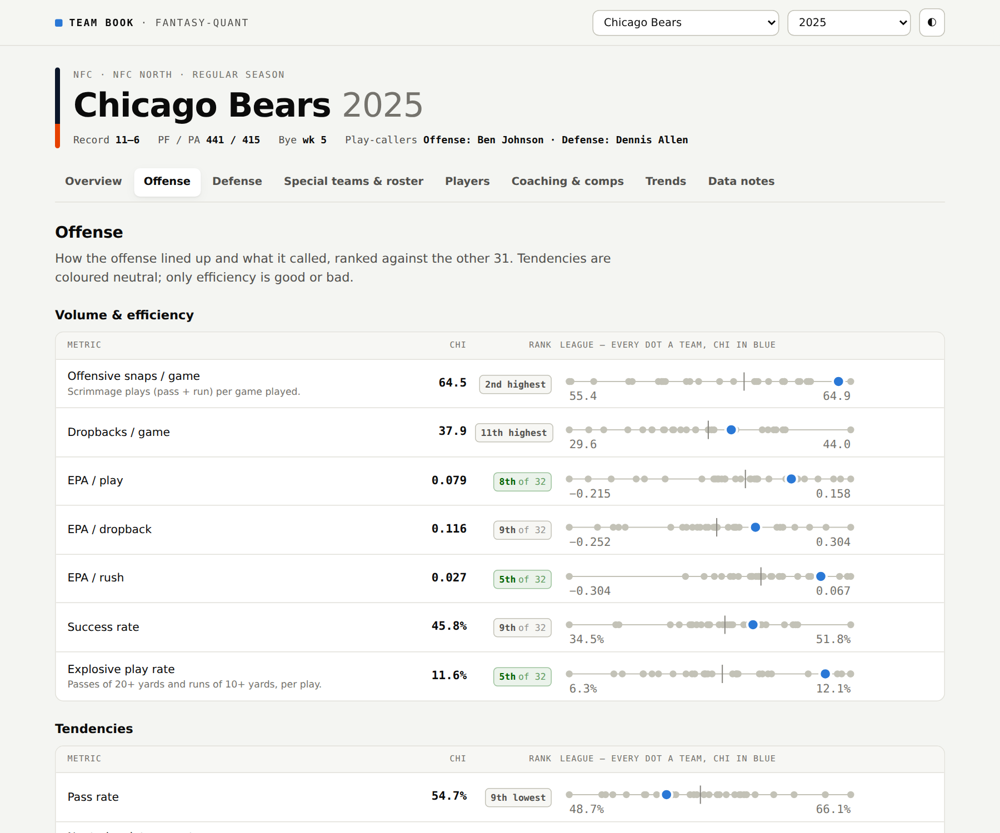

# fantasy-quant

[](https://github.com/rayhandriver/fantasy-quant/actions/workflows/ci.yml)
[](https://github.com/rayhandriver/fantasy-quant/actions/workflows/teambook-weekly.yml)

fantasy-quant is an NFL analytics project that applies methods from quantitative portfolio
management to football data. It started as a fantasy football draft model and grew into two
things people can use. The first is the [NFL Team Book](https://rayhandriver.github.io/fantasy-quant/),
a website that breaks down how every team has played since 2018. The second is a fantasy draft
engine and app that builds the roster a user wants and shows how much each of their preferences
costs compared to the consensus best team.

[](https://rayhandriver.github.io/fantasy-quant/#/CHI/2025/offense)

The project has about 32,000 lines of Python and more than 1,000 tests, written between June and
October 2026.

## NFL Team Book

The Team Book has a page for every team in every season from 2018 to the current one. Each page
covers the offense's personnel groupings, formations and play calling tendencies, the defense's
packages, coverage and pressure, the players who were on the field the most, and who called the
plays on each side. Every stat is ranked against the rest of the league, and each page lists the
five seasons from other franchises that played the most similar style. The 2025 Bears offense,
for example, comes out closest to the 2023 and 2024 Lions, when Ben Johnson was calling plays in
Detroit before taking the Chicago job.

The site is plain HTML and JavaScript that reads JSON files, so it runs on GitHub Pages without a
server. A GitHub Actions job rebuilds the current season every Tuesday and Wednesday straight from
the nflverse data releases, which means the weekly update does not depend on the local database.

## Project timeline

### Data and backtesting

From June 29 to July 3 I built the foundation. This was a DuckDB database of play by play data,
weekly stats, rosters, ADP snapshots, betting lines and injuries, along with a fantasy scoring
engine, a draft simulator and a backtesting harness that tests a method on past seasons and
reports bootstrap confidence intervals. Every query filters data by the date it was known, so a
model built for a given point in time cannot see anything that happened later.

### Changing the goal

On July 4 the first projection model went through the harness. It scored 59 fantasy points per
season worse than just drafting by ADP, with a 95 percent confidence interval from 162 points worse
to 33 points better. Based on the standard errors from that test, detecting even a large edge over
ADP would take about 27 seasons of data, and only about 10 exist. Instead of trying to beat
consensus, I changed the goal to something that can be checked within a single draft. The idea
comes from [direct indexing](docs/REFRAME-2026-07-04.md) in asset management, where you start
from the market's consensus, customize the portfolio to the client, and report what each
customization costs.

### Building the engine

From July 5 to 12 I built the main pieces. These were player values from consensus projections, a
distribution for each player's season that accounts for injuries and missed games, a covariance
model so the draft logic understands which players' outcomes move together, a Monte Carlo
simulation of the regular season and playoffs, and a draft strategy that plans around positional
scarcity. I also built in-season tools. A Kalman filter that updates projections each week beat
the preseason projections in all six seasons it was tested on, and a start/sit optimizer added
about 2.1 points per lineup per week.

### Audit and final test

From July 10 to 19 I audited the whole codebase and started a register of known problems. It now
has 57 entries, each with the cause, the fix and how the fix was checked. I also built a Monte
Carlo tree search drafter. It did better than the simpler greedy drafter on the model's own
objective, but it did not score more real fantasy points and took about 100 times longer per pick,
so I dropped it based on a bar I had set before running it. After that I froze the model, wrote
down exactly how it would be evaluated, and tested it once on the 2023 and 2024 seasons, which had
been held out of all development. Its championship probabilities scored a Brier score of 0.0884
against a 0.09 baseline, and its 80 percent prediction ranges contained 80.1 percent of actual
results for players who stayed healthy.

### Modeling real drafters

From July 23 to 30 I worked on predicting what the other people in a draft will do. A crawler over
Sleeper's public API grew the set of real drafts from 149 to 7,699, about 1.2 million picks, once I
found out the earlier crawl had stopped early instead of running out of drafts. At that size a
hardcoded label turned out to be mixing dynasty, superflex and IDP leagues in with standard PPR
drafts, which affected 82 percent of them. I re-ran everything that depended on the drafts after
fixing it, and two results I had believed turned out to be caused by the mix-up. The final
opponent model predicts real picks better than ADP alone, and the simulated draft room was checked
against 1,144 real drafts.

### App and scheme data

From July 30 to August 17 I built a Streamlit app for running drafts, with a live board, a draft
room, tags for players a user likes or wants to avoid, a report on what those preferences cost,
and grades after the draft. I also added support for other league formats like superflex, custom
scoring and keepers. The last piece was a scheme database built from nflverse's participation
data, which records all 22 players on the field for every play since 2016. That made it possible
to measure personnel groupings, formations, coverage and pressure, and to connect them to the
offensive and defensive play callers.

### The Team Book

In October I turned a one-off report I had built on the 2025 Bears into the Team Book, covering
every team and season, with the current season updating each week. While building it I found
three stats in the scheme database that were caused by changes in how the source data was
recorded rather than by anything on the field. Pressure rate was exactly 1.0 for every team
starting in 2023, and a change in formation labels zeroed out several formation rates. The site
now checks for this and refuses to publish any stat that is identical for all 32 teams.

## How I work

### Only past data

Every feature is filtered by date when it is read from the database, so a model can only see
information that existed at the time it is supposed to represent.

### Bars set in advance

Each step has a pass or fail bar written before the results are looked at, along with a check that
the bar is actually able to fail. Several ideas did not work out, and they are written up the same
way as the ones that did.

### One final test

All development used the 2014 to 2022 seasons. The 2023 and 2024 seasons were used once, at the
end, following a plan that was committed before the test ran.

### Reproducible results

Simulation results that changed slightly from run to run turned out to come from DuckDB adding
numbers in a different order on different threads, not from the random number code. Reads that
feed a simulation now run on a single thread and give the same answer every time.

### Missing is not zero

When a stat does not exist for a season, it is stored and shown as missing with a reason. It is
never filled in with a zero.

### A written record

[`findings.md`](findings.md) records what each step produced and what it showed,
[`PLAN.md`](PLAN.md) records decisions and dead ends, and [`docs/TECH-DEBT.md`](docs/TECH-DEBT.md)
lists every known problem and its fix.

## Architecture

```
nflverse, Sleeper, FantasyPros, FFC  ->  ingest and checks  ->  DuckDB  ->  draft engine  ->  Streamlit app
                                                                       ->  teambook       ->  site/data JSON  ->  GitHub Pages
nflverse (current season only)  ->  teambook/inseason.py, no database  ->  weekly Actions job
```

| Package | Purpose |
|---|---|
| `data/` | Downloads from nflverse, Sleeper, FantasyPros and FFC, builds the dated tables and checks them |
| `projections/`, `covariance/`, `valuation/` | Player values, outcome distributions, correlations and draft value |
| `draft/`, `simulation/` | Draft simulator, opponent model, draft strategy and season simulation |
| `inseason/` | Weekly projection updates, start/sit, waivers, streaming and trades |
| `situation/` | Scheme data from the participation file, coverage, play callers and scheme profiles |
| `teambook/` | Builds each team page, the weekly update and the website data |
| `backtest/` | Tests methods on past seasons with confidence intervals |

## Running it

```bash
uv sync --extra data                       # installs Python 3.12 and the locked dependencies
uv run python -m pytest -m "not needs_db"  # runs the tests that do not need the local database
uv run python -m http.server -d site       # serves the Team Book at localhost:8000
uv run python steps/teambook_export.py --live   # rebuilds the current season from nflverse
```

The scripts in `steps/` rebuild the full 765 MB database from public sources. Tests that need it
are marked `needs_db` and run locally. Once the database exists, the draft app runs with
`uv sync --extra ui && uv run streamlit run app/main.py`.

## Data sources

Play by play, participation, roster, contract, snap count and schedule data come from
[nflverse](https://github.com/nflverse) under the CC-BY 4.0 license. Play design, blitz and box
count charting comes from [FTN Data](https://ftnfantasy.com) through nflverse under the CC-BY-SA
4.0 license. Draft data comes from Sleeper's public API, ADP from Fantasy Football Calculator, and
consensus rankings from FantasyPros. All stats are from the regular season. This project is not
affiliated with the NFL or any team.

## Next steps

### League import

The draft app will be able to load a user's league settings directly from Sleeper and then ESPN,
so they do not have to be entered by hand.

### Full 2026 pages

nflverse usually publishes the season's participation data in February. Once it is out, the 2026
pages will get personnel, coverage and pressure numbers like the earlier seasons have.

### Matchup view

The Team Book will compare an offense's tendencies against the defense it faces each week.

### Fixing the source data

The pressure and formation problems are currently worked around in the Team Book. They should be
fixed in the scheme database itself, with a check that catches the next change of this kind when
the data is first loaded.

### Injury and role risk

The 80 percent prediction ranges hit 80 percent for players who stay healthy but only 72 percent
overall, because the model underestimates how often a projected starter loses their role or misses
the season. A model of depth chart and role changes is the planned fix.

### Hosted draft app

Putting the draft app online needs a smaller, read only copy of the database.

## Repository guide

| File | Contents |
|---|---|
| [`docs/STRATEGY.md`](docs/STRATEGY.md) | Why the project is set up this way and how it relates to quant finance |
| [`docs/REFRAME-2026-07-04.md`](docs/REFRAME-2026-07-04.md) | The July 4 change of goal and the numbers behind it |
| [`PROJECT.md`](PROJECT.md), [`ROADMAP.md`](ROADMAP.md) | Scope, phase plan and status |
| [`docs/BUILD_PLAN.md`](docs/BUILD_PLAN.md) | The step by step build plan with each step's pass or fail bar |
| [`findings.md`](findings.md), [`PLAN.md`](PLAN.md) | What each step found, and the decisions and dead ends along the way |
| [`docs/TECH-DEBT.md`](docs/TECH-DEBT.md) | The register of known problems |
| [`glossary.md`](glossary.md) | Fantasy and quant terms as this project uses them |
| [`CLAUDE.md`](CLAUDE.md) | Working rules for anyone changing the code |
